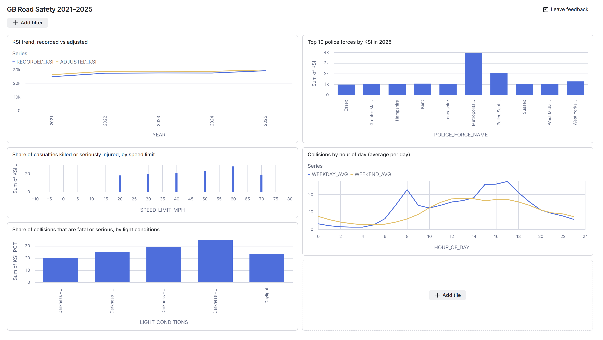
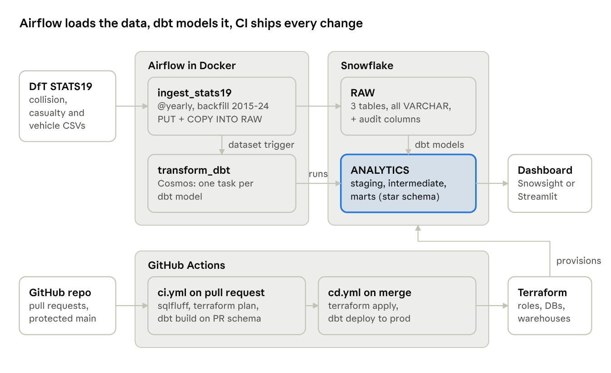
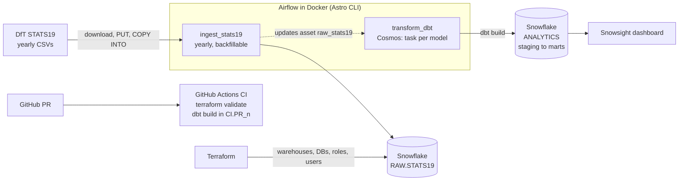
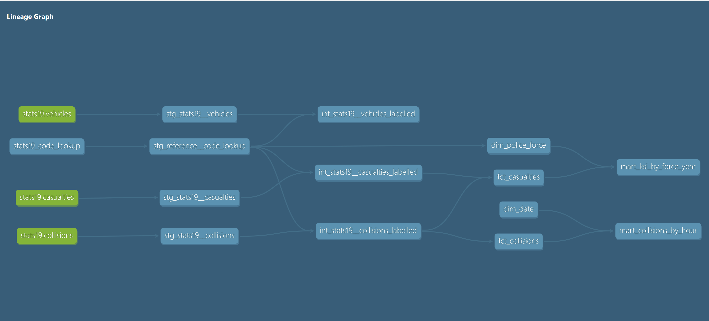
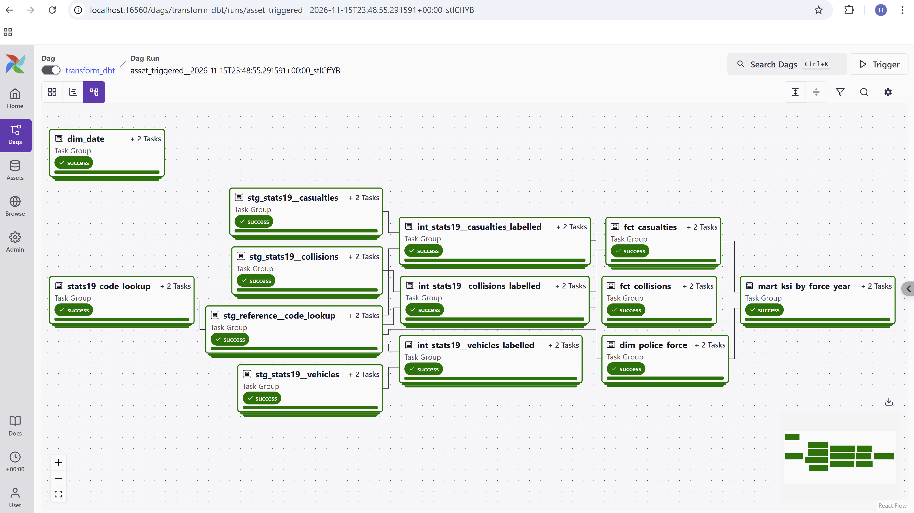
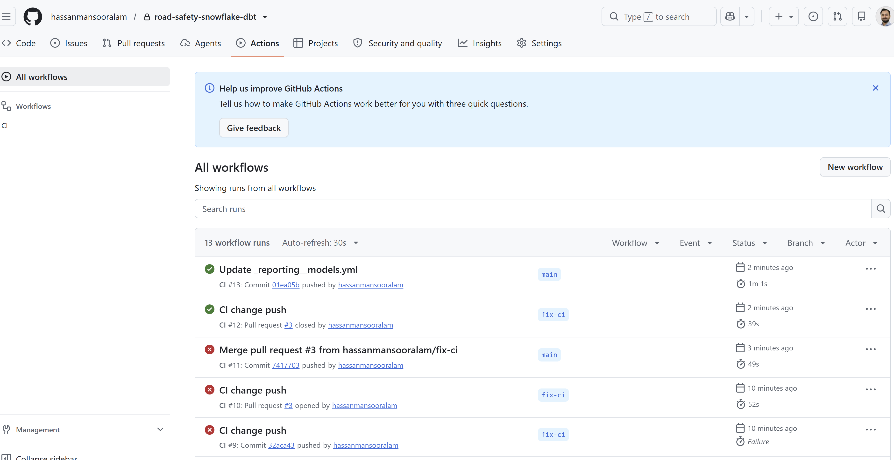

# GB Road Safety: a modern data stack pipeline

An end-to-end ELT pipeline for five years (2021–2025) of police-reported road collisions in Great Britain, built on Snowflake, dbt Core, Airflow (with Cosmos), Docker, Terraform and GitHub Actions.

The pipeline answers one question: **where and when are people killed or seriously injured on GB roads, and what conditions make a collision more severe?**



**Demo video:** Work in Progress
---

## At a glance

| | |
|---|---|
| Source | DfT STATS19 open data (collisions, casualties, vehicles), 2021–2025 |
| Volume | 513,801 collisions · 652,821 casualties |
| Warehouse | Snowflake (RAW → ANALYTICS), provisioned with Terraform |
| Ingestion | Airflow 3 DAG, one year per run, idempotent, backfillable |
| Transformation | dbt Core: 13 models, 1 seed, 45 data tests, staging → intermediate → marts |
| Orchestration | Asset-triggered dbt DAG rendered by Astronomer Cosmos (one task per model) |
| CI/CD | GitHub Actions: Terraform validate and dbt build on every PR into an isolated schema |
| Cost | 1.94 Snowflake credits for the whole build |

---

## Architecture





**Data flow:** `ingest_stats19` downloads one year of collision, casualty and vehicle files, uploads them to a Snowflake stage and loads them into `RAW.STATS19`. When the load finishes, it updates the Airflow asset `raw_stats19`, which triggers `transform_dbt`. That DAG runs the dbt project model by model and rebuilds the marts.

**Delivery flow:** every pull request runs Terraform checks and a full `dbt build` in its own Snowflake schemas. When the PR closes, a cleanup job drops those schemas.

---

## Findings

Based on 2021–2025 data. **KSI** = killed or seriously injured.

**1. Higher speed limits mean more severe outcomes, up to 60 mph.**

| Speed limit | Casualties | KSI % |
|---|---:|---:|
| 20 mph | 98,837 | 18.2% |
| 30 mph | 324,295 | 19.9% |
| 40 mph | 61,137 | 21.1% |
| 50 mph | 33,116 | 22.9% |
| 60 mph | 92,367 | **28.2%** |
| 70 mph | 43,066 | 19.0% |

The KSI share rises steadily from 20 mph to a peak at 60 mph, which covers most rural single-carriageway roads. It drops at 70 mph. Those roads are mostly motorways and dual carriageways, where opposing traffic is separated.

**2. Unlit roads at night are the most dangerous lighting condition.**

| Light conditions | Collisions | KSI % |
|---|---:|---:|
| Darkness – no lighting | 27,438 | **34.9%** |
| Darkness – lights unlit | 3,706 | 29.1% |
| Darkness – lights lit | 105,834 | 25.1% |
| Daylight | 368,193 | 23.2% |
| Darkness – lighting unknown | 8,596 | 19.9% |

Collisions on unlit roads in the dark are 1.5 times as likely to be fatal or serious as daylight collisions (34.9% vs 23.2%), even though they make up only 5% of collisions.

**3. Weekday collisions peak at the morning and evening rush hours,** while weekends show a single afternoon peak (see the hourly chart in the dashboard).

---

## Data model



| Layer | Models | Materialisation | Purpose |
|---|---|---|---|
| Seed | `stats19_code_lookup` | table | Code-to-label lookup built from the DfT data guide by `scripts/build_seeds.py` |
| Staging | `stg_stats19__collisions`, `__casualties`, `__vehicles`, `stg_reference__code_lookup` | view | Rename, type-cast, turn `-1` codes into nulls, build surrogate keys |
| Intermediate | `int_stats19__*_labelled` | view | Join codes to readable labels through a `join_label()` macro |
| Marts (core) | `fct_collisions`, `fct_casualties`, `dim_date`, `dim_police_force` | table / incremental | Star schema at two grains (collision, casualty) |
| Marts (reporting) | `mart_ksi_by_force_year`, `mart_collisions_by_hour` | table | Dashboard-ready aggregates |

`fct_casualties` is **incremental**: each run processes only rows with a newer `_loaded_at` and merges them on `casualty_id`, so reloading a year never duplicates data.

`adjusted_ksi` uses the DfT's modelled severity probabilities. Police forces moved to an injury-based recording system (CRASH) at different times, which changed how serious injuries are classified. The adjusted figure makes forces and years comparable.

---

## Design decisions

**Idempotent, backfillable loads.** Each ingest run deletes that year's rows and runs `COPY INTO` in one transaction, with `FORCE = TRUE` (otherwise Snowflake skips files it has loaded before). Re-running any year gives the same row counts, which makes backfills and retries safe.

**Schema drift handled at ingestion.** RAW tables are created from each file's header row, with every column as `VARCHAR` plus audit columns (`_source_file`, `_data_year`, `_loaded_at`). If a later year adds a column, the load adds it with `ALTER TABLE`. Typing and cleaning happen in dbt staging, not in the loader.

**Event-driven transformation.** `transform_dbt` is scheduled on the `raw_stats19` Airflow asset, not on a clock, so dbt runs only when new data lands. When several loads finish close together, Airflow batches them into one dbt run, and the incremental model picks up all the new rows at once.

**One Airflow task per dbt model.** Cosmos renders the dbt project as task groups (run + test per model), so a failure points to a specific model and can be retried on its own. dbt runs in its own virtualenv inside the Airflow image to avoid dependency clashes.

**Least-privilege access as code.** Terraform manages three warehouses, three databases, three roles (`LOADER`, `TRANSFORMER`, `REPORTER`) and three service users with key-pair authentication. Future grants keep the reporting role's access when dbt replaces tables. Stages and file formats are created in the load SQL, because the Snowflake Terraform provider marks them as preview features.

**Isolated CI.** Every PR builds the full project into its own schemas (`CI.PR_<n>_*`) as a dedicated CI user, then drops them when the PR closes. Main builds into `CI.MAIN_*`.

**Cost control.** X-Small warehouses with a 60-second auto-suspend, plus a resource monitor that notifies at 50% and suspends at 90% of the monthly quota. The whole build, including backfills and CI runs, used 1.94 credits.

---

## Data quality

- 45 dbt tests: `unique` and `not_null` on every key, `relationships` from facts to dimensions and between facts, `accepted_values` on severity codes, and range checks on speed limits and adjusted KSI.
- Label coverage is monitored with warn-level tests. A small number of source codes (under 0.1% of rows, for example some vehicle type codes) have no entry in the DfT guide. They are kept, not dropped, and reported as warnings.
- `dbt source freshness` checks the RAW tables using `_loaded_at`, with thresholds set for yearly publication.

---

## Screenshots

| Airflow: asset-triggered dbt DAG | GitHub Actions CI |
|---|---|
|  |  |

---

## Tech stack

| Area | Tool |
|---|---|
| Warehouse | Snowflake |
| Infrastructure as code | Terraform, `snowflakedb/snowflake` provider v2 |
| Orchestration | Apache Airflow 3 (Astro CLI, Docker) |
| dbt in Airflow | Astronomer Cosmos |
| Transformation | dbt Core 1.12, dbt-snowflake, dbt_utils |
| CI | GitHub Actions |
| Dashboard | Snowsight |
| Language | Python, SQL |

---

## Repository structure

```text
.
├── .github/workflows/ci.yml        # PR checks: terraform validate, dbt build, schema cleanup
├── Terraform/                      # Snowflake warehouses, databases, roles, users, grants
├── Airflow/
│   ├── Dockerfile                  # Astro runtime + dbt virtualenv
│   ├── requirements.txt            # Snowflake provider, Cosmos
│   ├── include/dbt/profiles.yml    # dbt profile used inside the container
│   └── dags/
│       ├── ingest_data.py          # ingest_stats19: yearly, idempotent load to RAW
│       ├── transform_dbt.py        # transform_dbt: asset-triggered Cosmos DAG
│       └── dbt/road_safety/        # the dbt project
├── scripts/build_seeds.py          # builds the code lookup seed from the DfT data guide
└── docs/screenshots/
```

---

## How to run it

**Prerequisites:** a Snowflake account (the 30-day trial is enough), Docker Desktop, the Astro CLI, Terraform, Python 3.12 and Git Bash (for OpenSSL).

**1. Generate key pairs** (from the repo root, in Git Bash). The `keys/` folder is gitignored.

```bash
mkdir -p keys
for name in terraform airflow dbt ci; do
  openssl genrsa 2048 | openssl pkcs8 -topk8 -inform PEM -out keys/${name}.p8 -nocrypt
  openssl rsa -in keys/${name}.p8 -pubout -out keys/${name}.pub
done
```

**2. Bootstrap the Terraform user.** This is the only manual step. In a Snowsight worksheet, as `ACCOUNTADMIN`:

```sql
CREATE USER TERRAFORM_SVC TYPE = SERVICE
  RSA_PUBLIC_KEY = '<contents of keys/terraform.pub without the BEGIN/END lines>'
  DEFAULT_ROLE = ACCOUNTADMIN;
GRANT ROLE ACCOUNTADMIN TO USER TERRAFORM_SVC;
```

**3. Provision Snowflake.** Create `Terraform/terraform.tfvars` with your `snowflake_organization` and `snowflake_account`, then run:

```bash
cd Terraform
terraform init
terraform apply
```

**4. Configure Airflow.** Copy `keys/airflow.p8` and `keys/dbt.p8` into `Airflow/include/keys/`. Then create `Airflow/.env` containing the Snowflake connection (`AIRFLOW_CONN_SNOWFLAKE_DEFAULT`, key-pair auth as `AIRFLOW_SVC`) and `SNOWFLAKE_ACCOUNT`.

**5. Start Airflow and load the data.**

```bash
cd Airflow
astro dev start
```

Open http://localhost:8080, unpause both DAGs and backfill `ingest_stats19` from 2021-01-01. `transform_dbt` runs automatically after each load.

**6. CI.** Add the repository secrets `SNOWFLAKE_ACCOUNT` and `SNOWFLAKE_CI_PRIVATE_KEY` (the contents of `keys/ci.p8`).

---

## Limitations and next steps

- **Terraform runs locally.** State is on the developer's machine, so CI only runs `fmt` and `validate`. Next: move state to a remote backend (HCP Terraform or S3) and add `terraform plan` on PRs and `apply` on merge.
- **CI rebuilds everything.** The project is small, so a full build takes about a minute. At scale, I would add Slim CI (`state:modified+` with `--defer` against the production manifest) to build only changed models.
- **No separate production target.** Airflow builds into the `dev` target. Next: a `prod` target with clean schema names through a custom `generate_schema_name` macro.
- **Airflow runs on a laptop.** The same DAGs would deploy unchanged to a managed service such as Astro or Amazon MWAA.
- **dbt deprecation warnings.** Generic test arguments should move under `arguments:`, and source `freshness` under `config:`, to match newer dbt conventions.

---

## Data source and licence

Road Safety Data (STATS19), Department for Transport, published under the [Open Government Licence v3.0](https://www.nationalarchives.gov.uk/doc/open-government-licence/version/3/). Source: [data.gov.uk – Road Safety Data](https://www.data.gov.uk/dataset/cb7ae6f0-4be6-4935-9277-47e5ce24a11f/road-safety-data).

---

**Hassan Mansoor** · [GitHub](https://github.com/hassanmansooralam) · https://www.linkedin.com/in/hassanmansooralam/
